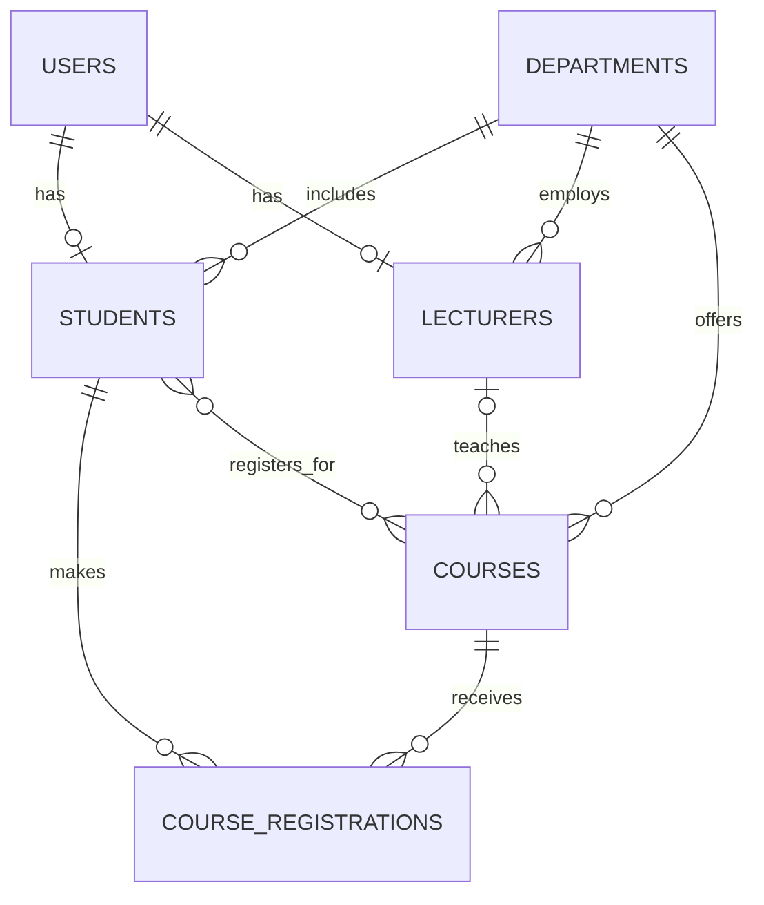

# Student Management System Database

The database uses InnoDB-compatible foreign keys and Eloquent models. `departments` is included as a normalized parent entity because students, lecturers, and courses belong to academic departments. User roles remain the existing `users.role` values (`admin`, `lecturer`, and `student`) so the current authentication and authorization code continues to work.

## ER diagram

`COURSE_REGISTRATIONS` is the association entity for the student/course many-to-many relationship. It stores the term, registration status, grade, and timestamps rather than placing enrollment-specific data on either parent table.

## Tables

| Table | Purpose and important columns | Constraints and deletion behavior |
|---|---|---|
| `users` | Authentication identity: `name`, unique `email`, password, contact/profile fields, and `role`. The role values used by the app are `admin`, `lecturer`, and `student`. | Email is unique. |
| `departments` | Academic unit with `name`, unique `code`, optional description and building. | Referenced by students and lecturers with `SET NULL`; referenced by courses with `CASCADE`. |
| `students` | Student profile: `user_id`, optional `department_id`, unique `student_id_number`, program, year of study, and status. | One profile per user; deleting the user deletes the profile; deleting a department sets the department reference to null. |
| `lecturers` | Lecturer profile: `user_id`, optional `department_id`, unique `staff_id`, title, qualification, and office. | One profile per user; deleting the user deletes the profile; deleting a department sets the department reference to null. |
| `courses` | Course catalog/offering: department, optional lecturer, unique code, title, credits, semester/year, capacity, room, and schedule. | Department is required and cascades on delete; deleting the lecturer sets `lecturer_id` to null. |
| `course_registrations` | Enrollment record: student, course, semester, academic year, status, and optional grade. | Both parent deletions cascade. `(student_id, course_id, academic_year, semester)` is unique, so duplicate enrollment in the same course offering is rejected by the database. |

Laravel's authentication migrations also create the framework tables `password_reset_tokens`, `sessions`, cache, queue, and token tables; they are framework infrastructure rather than student-domain entities.

## Eloquent relationships

| Model | Relationship methods |
|---|---|
| `User` | `hasOne(Student)`, `hasOne(Lecturer)` |
| `Department` | `hasMany(Student)`, `hasMany(Lecturer)`, `hasMany(Course)` |
| `Student` | `belongsTo(User)`, `belongsTo(Department)`, `hasMany(CourseRegistration)`, `belongsToMany(Course)` |
| `Lecturer` | `belongsTo(User)`, `belongsTo(Department)`, `hasMany(Course)` |
| `Course` | `belongsTo(Department)`, `belongsTo(Lecturer)`, `hasMany(CourseRegistration)`, `belongsToMany(Student)` |
| `CourseRegistration` | `belongsTo(Student)`, `belongsTo(Course)` |

The many-to-many relationships expose pivot columns `id`, `semester`, `academic_year`, `status`, and `grade`, and include pivot timestamps. For enrollment operations that need a first-class record, use `CourseRegistration`.

## Migrations, seeders, factories, and tests

Run `php artisan migrate` to create the schema and `php artisan db:seed` to insert the repeatable demonstration dataset. The seed includes an administrator, three lecturers, five students, six courses, and registrations. Demo account passwords are `password`; change these credentials outside local/demo environments.

`database/factories` provides factories for users, departments, students, lecturers, courses, and registrations. PHPUnit coverage for all model relationships, duplicate-registration prevention, seed repeatability, and minimum seed counts is in `tests/Feature/DatabaseRelationshipsTest.php`.
